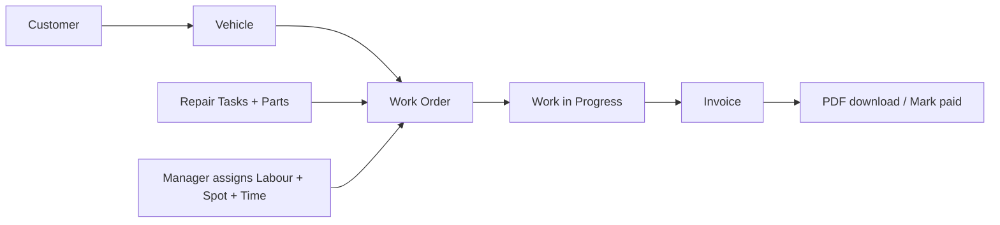
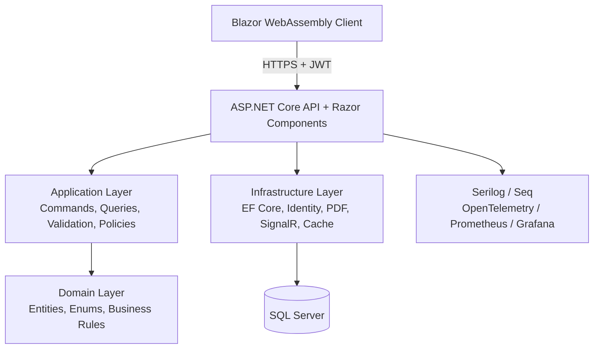
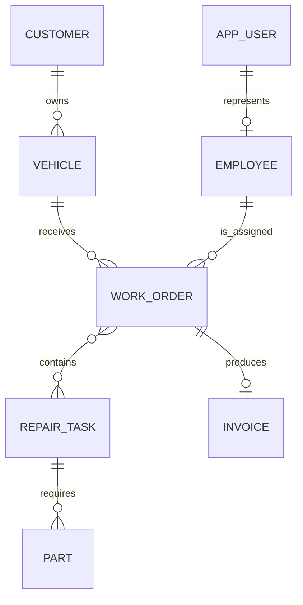
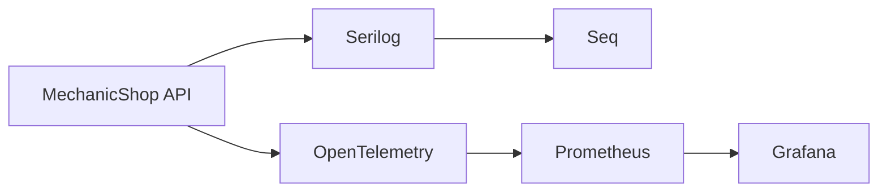

# 🔧 MechanicalShop — Workshop Operations Platform

> A modern web application for running an automotive repair workshop: manage customers and vehicles, schedule workshop bays, assign labour, build repair work orders, and produce invoices. Built with **.NET 10**, **Clean Architecture**, **Blazor WebAssembly**, and **SQL Server**.

[](https://dotnet.microsoft.com/)
[](https://learn.microsoft.com/aspnet/core/)
[](https://www.microsoft.com/sql-server)
[](https://dotnet.microsoft.com/apps/aspnet/web-apps/blazor)

**Live site:** [mechanicshop1.runasp.net](https://mechanicshop1.runasp.net/)<br>
**Demo video:** [Open the demo folder](https://drive.google.com/drive/folders/1ZucFrs5UYB3Rbrj4wAJ3b-SAyUF-rC4g?usp=sharing)

---

## Table of Contents

- [Overview & Vision](#overview--vision)
- [User Roles & Main Workflows](#user-roles--main-workflows)
- [System Architecture](#system-architecture)
- [Technology Stack](#technology-stack)
- [Domain & Data Architecture](#domain--data-architecture)
- [Security, Reliability & Operations](#security-reliability--operations)
- [Project Status & Roadmap](#project-status--roadmap)
- [Architectural Decision Records](#architectural-decision-records)
- [Getting Started](#getting-started)
- [Deployment to MonsterASP](#deployment-to-monsterasp)
- [Troubleshooting](#troubleshooting)
- [Contribution Workflow](#contribution-workflow)

---

## Overview & Vision

MechanicalShop brings the day-to-day work of a repair garage into one place. It helps a manager see the workshop schedule, avoid booking collisions between bays, track the services performed on each vehicle, and turn completed work into an invoice.

The application keeps customer, vehicle, repair task, labour assignment, work order, and invoice information connected. That makes it possible to move from a booking to a completed repair and then to billing without re-entering the same data.

### Product Goals

- Keep the workshop schedule clear by using named service spots and time-based work orders.
- Keep a complete link from a customer to their vehicle, repair tasks, assigned labour, and invoice.
- Give managers and labour staff only the access that is relevant to their role.
- Keep the user interface responsive while the API handles business rules, validation, and persistence.
- Provide a deployment path that works locally with Docker and in production on IIS / MonsterASP.

---

## User Roles & Main Workflows

### Manager

The Manager has access to workshop administration and operational planning:

- Create and maintain customers and their vehicles.
- Create repair tasks, labour pricing, expected duration, and required parts.
- Schedule a work order in a workshop spot and assign a labour employee.
- Follow work-order state changes and reschedule when needed.
- Create invoices, download a PDF, and mark invoices as paid.

### Labour Employee

The Labour role is scoped to work assigned to that employee:

- View assigned work orders.
- Follow the planned repair work and its current state.
- Receive live updates when workshop work changes.

### Workshop Flow



---

## System Architecture

MechanicalShop is a hosted Blazor WebAssembly application built as a modular monolith. The codebase separates business rules from technical infrastructure while keeping deployment simple.



### Core Architectural Principle

> Keep the domain independent from frameworks, keep use cases in the application layer, and isolate databases, identity, PDFs, and real-time delivery behind infrastructure services.

### Solution Layout

```text
Mechanical-Shop/
├── src/
│   ├── MechanicShop.Api/            # Host, controllers, middleware, OpenAPI, DI composition
│   ├── MechanicShop.Client/         # Blazor WebAssembly user interface
│   ├── MechanicShop.Application/    # Use cases, MediatR behaviours, validation and policies
│   ├── MechanicShop.Contracts/      # Shared DTOs and contracts
│   ├── MechanicShop.Domain/         # Entities, value objects, enums and domain rules
│   └── MechanicShop.Infrastructure/ # EF Core, Identity, SignalR, PDF, caching, background jobs
├── tests/                           # Automated test projects
├── containers/                      # Monitoring container configuration
├── docker-compose.yml               # Local application, SQL Server, Seq, Prometheus and Grafana
└── MechanicShop.slnx                # Solution file
```

---

## Technology Stack

| Area | Technology | Why it is used |
|---|---|---|
| Runtime | .NET 10 / C# | Modern, cross-platform application runtime. |
| Web host | ASP.NET Core | API endpoints, Razor Components, middleware, authentication, and OpenAPI. |
| Frontend | Blazor WebAssembly | Rich browser UI written in C# and hosted by the API. |
| Architecture | Clean Architecture + feature-oriented application layer | Keeps business rules testable and infrastructure replaceable. |
| Database | SQL Server | Relational storage for workshop, identity, and billing data. |
| Data access | Entity Framework Core | Strongly typed persistence and entity configuration. |
| Application flow | MediatR + FluentValidation | Separates requests from handlers and validates input before processing. |
| Identity | ASP.NET Core Identity + JWT bearer tokens | Password hashing, roles, and token-based client access. |
| Real time | SignalR | Pushes work-order changes to connected clients. |
| Invoices | QuestPDF | Generates downloadable invoice PDFs. |
| Observability | Serilog, Seq, OpenTelemetry, Prometheus, Grafana | Structured logs, traces, metrics, and dashboards. |
| Local environment | Docker Compose | Starts the API, SQL Server, Seq, Prometheus, and Grafana together. |
| CI/CD | GitHub Actions + Web Deploy | Builds, tests, and publishes the web application to MonsterASP. |

---

## Domain & Data Architecture

The domain centres on the service history of a vehicle. A customer may own several vehicles, and each vehicle can have many work orders over time. A work order combines scheduled workshop time, a physical spot, a labour employee, and one or more repair tasks.



### Module Highlights

| Module | Responsibilities |
|---|---|
| Customers & Vehicles | Customer contact details and the vehicles brought to the workshop. |
| Employees & Roles | Employee details connected to Identity users and Manager / Labour roles. |
| Repair Catalogue | Repair tasks, labour cost, expected duration, and required parts. |
| Workshop Scheduling | Work order placement by date, time, labour employee, and workshop spot. |
| Billing | Invoice generation, PDF export, and payment state. |
| Identity & Tokens | JWT token generation, authentication, authorization, and refresh-token storage. |
| Notifications | SignalR-based work-order updates and application notifications. |

### Scheduling Rules

The application models workshop capacity using four named spots: **A**, **B**, **C**, and **D**. The work-order policy checks scheduling constraints so that workshop time and resources are managed consistently.

---

## Security, Reliability & Operations

### Security

- **ASP.NET Core Identity** stores credentials using secure password hashing.
- **JWT bearer authentication** protects API access from the Blazor client.
- **Role-based authorization** supports Manager-only actions and scoped work-order access for labour employees.
- **CORS** is configured from application settings instead of being open by default.
- **Rate limiting** protects endpoints with a sliding-window limiter.
- **Problem Details** provides consistent error responses without exposing implementation details.

### Reliability & Performance

- EF Core changes pass through an **auditable save interceptor**.
- **HybridCache** is used for short-lived application caching.
- A hosted background service cleans up overdue bookings according to application configuration.
- SignalR publishes work-order changes without browser polling.
- Output caching and structured request logging reduce repeated processing and improve diagnosis.

### Observability



Docker Compose includes the following development services:

| Service | Default URL / Port | Purpose |
|---|---|---|
| MechanicalShop | `http://localhost:5001` | Application UI and API. |
| SQL Server | `localhost:1433` | Primary relational database. |
| Seq | `http://localhost:8081` | Structured log viewer. |
| Prometheus | `http://localhost:9090` | Metrics collection. |
| Grafana | `http://localhost:3000` | Metrics dashboards. |

---

## Project Status & Roadmap

### Implemented

- [x] Clean Architecture solution with Domain, Application, Infrastructure, API, Client, and Contracts projects.
- [x] Customer and vehicle management.
- [x] Repair task and parts catalogue.
- [x] Work-order scheduling with spots, duration, state, and labour assignment.
- [x] Manager and Labour authorization roles.
- [x] JWT authentication and refresh-token persistence.
- [x] Invoice lifecycle, PDF generation, and payment marking.
- [x] SignalR work-order notifications.
- [x] Docker-based local stack with monitoring services.
- [x] GitHub Actions build, test, and MonsterASP deployment workflow.

### Potential Next Steps

- [ ] Add richer workshop reports for repair volume, labour utilization, and paid / unpaid invoices.
- [ ] Add customer communication for booking reminders and repair completion notices.
- [ ] Add integration and end-to-end test coverage for the highest-value workshop flows.
- [ ] Add a custom domain and HTTPS-only production configuration.

---

## Architectural Decision Records

### ADR-001: Clean Architecture with a hosted Blazor client

**Context:** The application needs a rich web interface and a maintainable backend without the cost of managing separate frontend and API deployments.

**Decision:** Use an ASP.NET Core host with a Blazor WebAssembly client, plus independent Domain, Application, and Infrastructure layers.

**Outcome:** The UI can evolve independently from business rules, while a single host can serve the production application.

### ADR-002: Workshop planning uses work orders, spots, and time ranges

**Context:** A repair workshop has limited physical capacity. A simple appointment table cannot express the link between a repair, its assigned labour employee, the vehicle, and the workshop bay.

**Decision:** Model a work order with a start time, end time, service spot, assigned labour employee, vehicle, and repair tasks.

**Outcome:** The business can plan practical repair work and apply scheduling rules consistently.

### ADR-003: Identity users and employee records are separate

**Context:** Authentication data and workshop employee data have different responsibilities.

**Decision:** Use ASP.NET Core Identity for authentication and a separate Employee domain entity for workshop information and role-specific business rules.

**Outcome:** Identity remains secure and reusable while domain rules operate on business-focused employee data.

### ADR-004: Generate invoices as PDFs in the application

**Context:** Managers need a downloadable, shareable invoice without relying on an external document service.

**Decision:** Generate invoice PDFs through QuestPDF behind an invoice-generator interface.

**Outcome:** The PDF implementation is isolated from the application layer and can be replaced if requirements change.

### ADR-005: Publish to IIS as x64

**Context:** QuestPDF loads native rendering dependencies. A generic `Any CPU` deployment can fail when the host process architecture does not match its native dependency.

**Decision:** Build the API startup project for `x64` and publish the MonsterASP artifact for `win-x64`.

**Outcome:** The deployed application can load QuestPDF’s native renderer reliably on the configured IIS application pool.

---

## Getting Started

### Prerequisites

- [.NET 10 SDK](https://dotnet.microsoft.com/download)
- [Docker Desktop](https://www.docker.com/products/docker-desktop/) for the full local stack
- Git
- Visual Studio 2022, JetBrains Rider, or Visual Studio Code

### 1. Clone the Repository

```bash
git clone https://github.com/fou1100ouacus/Mechanical-Shop.git
cd Mechanical-Shop
```

### 2. Run the Full Local Stack with Docker

```bash
docker compose up --build
```

Open the application at `http://localhost:5001`.

In the Development environment, the application initializes and seeds the local database. The local demo manager account is:

| Role | Email | Password |
|---|---|---|
| Manager | `pm@localhost` | `pm@localhost` |

> The demo account is for local development only. Do not use this password for a public deployment.

### 3. Run Without Docker

Configure SQL Server and set a development connection string first. For example:

```powershell
$env:ConnectionStrings__DefaultConnection = 'Server=localhost;Database=MechanicShopDb;Trusted_Connection=True;TrustServerCertificate=True;MultipleActiveResultSets=True'
dotnet restore
dotnet run --project .\src\MechanicShop.Api\MechanicShop.Api.csproj
```

### 4. Run the Tests

```bash
dotnet test MechanicShop.slnx
```

### 5. Explore the API in Development

When the host runs with `ASPNETCORE_ENVIRONMENT=Development`, Swagger UI and Scalar OpenAPI are available from the API host.

---

## Deployment to MonsterASP

The repository includes a GitHub Actions workflow that builds, tests, publishes the API for Windows x64, and deploys to MonsterASP through Web Deploy.

### GitHub Repository Secrets

In **GitHub → Settings → Secrets and variables → Actions**, add the following repository secrets:

| Secret | Value |
|---|---|
| `WEBSITE_NAME` | Your MonsterASP site name, for example `site105758`. |
| `SERVER_COMPUTER_NAME` | `https://<site-name>.siteasp.net:8172` |
| `SERVER_USERNAME` | Your MonsterASP Web Deploy login. |
| `SERVER_PASSWORD` | Your MonsterASP Web Deploy password. |

Push to `main` to run the workflow. You can also run it manually from the **Actions** tab.

### Production Database Connection

In MonsterASP’s environment variables, set `ConnectionStrings__DefaultConnection` to the **Local Access** SQL Server connection string shown in the database settings. Use the local hostname from MonsterASP for the deployed site; do not use `Server=.` or Windows authentication.

### First-Time Demo Data Seeding

If a new production database needs the optional sample data, add these temporary environment variables in MonsterASP:

| Name | Value |
|---|---|
| `Database__SeedDemoData` | `true` |
| `Database__InitialUserPassword` | A new strong password you choose. |

Restart the application pool. The seed account is `pm@localhost` and uses the password provided in `Database__InitialUserPassword`. After the data exists, delete both variables and restart the application pool again.

---

## Troubleshooting

| Symptom | Likely Cause | Resolution |
|---|---|---|
| `HTTP Error 500.30` after deployment | Missing runtime dependency, wrong app architecture, or invalid configuration. | Check MonsterASP Event Logs and use the `win-x64` publish workflow. |
| QuestPDF cannot load `QuestPdfSkia` | Application ran with an incompatible architecture. | Keep the API startup project on `x64` and publish for `win-x64`. |
| Empty tables on a new production database | Production seeding is disabled by default. | Use the temporary seeding variables above, restart, then remove them. |
| Login fails for `pm@localhost` | The password is different from the configured production seed password. | Use `Database__InitialUserPassword`; the local `pm@localhost` password applies only to Development. |
| Application cannot connect to SQL Server | The host uses a local or Windows-authenticated connection string. | Use MonsterASP’s Local Access connection string in `ConnectionStrings__DefaultConnection`. |
| Blazor page is blank after manual upload | The published folder structure was changed during upload. | Upload the complete publish output so `wwwroot/_framework` remains under the application root. |

---

## Contribution Workflow

Use a branch and pull-request workflow to keep the deployment branch stable:

```bash
# Update your local main branch
git checkout main
git pull origin main

# Create a focused branch
git checkout -b feature/short-description

# Make changes, then verify them
dotnet test MechanicShop.slnx
git add .
git commit -m "feat(work-orders): add short description"

# Push the branch and open a pull request
git push -u origin feature/short-description
```

Prefer [Conventional Commits](https://www.conventionalcommits.org/): `feat:`, `fix:`, `docs:`, `refactor:`, `test:`, and `chore:`.

---

## License

No license file is currently included. Add a license before distributing the project outside its intended use.
