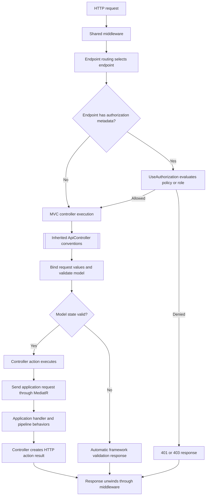
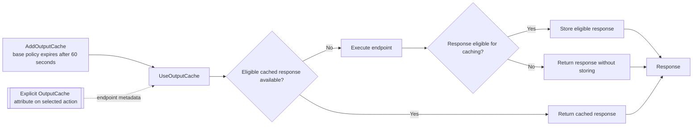

# Filters Applied in This Project

> **Scope:** ASP.NET Core API source on the repository's `main` branch, inspected through the connected GitHub integration. This document records attributes and filter-related registrations found in source. It does not claim runtime verification.

## Executive summary

The API does **not** define or globally register custom ASP.NET Core MVC filters in the inspected source. Its controller registration in [DependencyInjection.cs](../../src/MechanicShop.Api/DependencyInjection.cs) calls `AddControllers().AddJsonOptions(...)`; it does not configure `MvcOptions.Filters`.

The project does use framework attributes and middleware that can be mistaken for filters:

- `[ApiController]` enables ASP.NET Core API-controller conventions.
- `[Authorize]` and its policy/role forms provide endpoint authorization metadata enforced by `UseAuthorization()`.
- `[OutputCache]` opts selected actions into output caching handled by `UseOutputCache()`.
- Routing, binding, API-versioning, and OpenAPI attributes describe endpoint behavior or metadata; they are not custom MVC filters.

## Filter inventory

| Construct | Source locations | How it is applied |
|---|---|---|
| `[ApiController]` | [ApiController.cs](../../src/MechanicShop.Api/Controllers/ApiController.cs), inherited by the API controllers | ASP.NET Core API-controller conventions apply to the controller endpoints, including automatic invalid-model-state responses. No project-authored filter class is involved. |
| `[Authorize]`, `[Authorize(Policy = ...)]`, `[Authorize(Roles = ...)]` | Controller/action metadata in Customers, Dashboard, Invoices, Labors, RepairTasks, WorkOrders, and the current-user action in Identity | Endpoint authorization metadata is evaluated by the authorization middleware. This is not evidence of custom MVC filter implementations. |
| `[OutputCache(Duration = 60)]` | Customers list and by-id actions; Labors GET; RepairTasks list and by-id actions | Endpoint metadata used by the output-cache middleware. Five actions have explicit attributes. |
| `[Route]`, HTTP verb attributes, API-version attributes, binding attributes | Controller and action declarations | Routing, version selection, and model-binding metadata. |
| `[ProducesResponseType]`, `[EndpointSummary]`, `[EndpointDescription]`, `[EndpointName]` | Controller actions | Response or OpenAPI metadata. These do not implement request-execution filters. |

The inspected Identity token actions and Settings controller have no class-level `[Authorize]` attribute. This documents their attribute declarations only; other application security behavior may exist outside these declarations.

### Custom filter registration check

The inspected API startup, presentation registration, and controller source show:

- no `MvcOptions.Filters` configuration;
- no global `options.Filters.Add(...)` registration;
- no project-defined `IActionFilter`, `IAsyncActionFilter`, `IResourceFilter`, `IExceptionFilter`, `IResultFilter`, or `IEndpointFilter` implementation.

The base controller's `Problem(List<Error>)` helper in [ApiController.cs](../../src/MechanicShop.Api/Controllers/ApiController.cs) returns an action result; it is not a filter. The registered [GlobalExceptionHandler](../../src/MechanicShop.Api/Infrastructure/GlobalExceptionHandler.cs) is an `IExceptionHandler` used by exception-handling middleware, not an MVC exception filter.

Swagger UI's `.EnableFilter()` call in [Program.cs](../../src/MechanicShop.Api/Program.cs) configures filtering in the Swagger UI document list. It does not register a server-side MVC filter.

## Controller request path

### Diagram explanation

`Program.cs` applies the shared middleware chain before endpoint execution. Routing selects the controller/action endpoint and exposes its metadata. For protected endpoints, `UseAuthorization()` evaluates the `[Authorize]` metadata; a denied request can end before the controller action runs.

When MVC executes the endpoint, inherited `[ApiController]` conventions participate in request binding and validation. Invalid model state can produce an automatic framework response before the action executes. A valid request enters the action. The controllers send application commands or queries through MediatR, then map the returned result to an HTTP action result.

No custom MVC filter stage is shown because the inspected source contains no custom filter implementation or global MVC filter registration. ASP.NET Core's built-in MVC execution behavior still applies.

## Output-cache behavior

### Diagram explanation

The API calls `AddOutputCache` to register output caching and a 60-second base policy, then calls `UseOutputCache()` in the shared middleware chain after authorization. The explicit `[OutputCache(Duration = 60)]` attributes appear on five actions:

1. Customers list
2. Customers by ID
3. Labors GET
4. RepairTasks list
5. RepairTasks by ID

The diagram represents the middleware's cache-or-execute decision at a high level. Source attributes alone do not prove that a particular response is eligible, that it is stored, or that a request receives a cache hit.

## Validation and exception handling are separate

The API's `AddValidation()` method is empty. Application validation is registered in the Application project through MediatR pipeline behavior and validators; it runs as part of MediatR request handling, not as an ASP.NET Core MVC filter. See [dependency-injection.md](dependency-injection.md).

The exception handler registered by `AddExceptionHandler<GlobalExceptionHandler>()` and activated with `UseExceptionHandler()` is middleware-level exception handling. It should not be described as an MVC exception filter.

## Source references

- [API startup and endpoint mapping](../../src/MechanicShop.Api/Program.cs)
- [Presentation service registration and middleware order](../../src/MechanicShop.Api/DependencyInjection.cs)
- [API controller base and result helper](../../src/MechanicShop.Api/Controllers/ApiController.cs)
- Controllers: [Customers](../../src/MechanicShop.Api/Controllers/CustomersController.cs), [Dashboard](../../src/MechanicShop.Api/Controllers/DashboardController.cs), [Identity](../../src/MechanicShop.Api/Controllers/IdentityController.cs), [Invoices](../../src/MechanicShop.Api/Controllers/InvoicesController.cs), [Labors](../../src/MechanicShop.Api/Controllers/LaborsController.cs), [RepairTasks](../../src/MechanicShop.Api/Controllers/RepairTasksController.cs), [Settings](../../src/MechanicShop.Api/Controllers/SettingsController.cs), [WorkOrders](../../src/MechanicShop.Api/Controllers/WorkOrdersController.cs)
- [Global exception handler](../../src/MechanicShop.Api/Infrastructure/GlobalExceptionHandler.cs)

## Framework references

- [ASP.NET Core filters](https://learn.microsoft.com/en-us/aspnet/core/mvc/controllers/filters?view=aspnetcore-10.0)
- [ASP.NET Core output caching](https://learn.microsoft.com/en-us/aspnet/core/performance/caching/output?view=aspnetcore-10.0)
