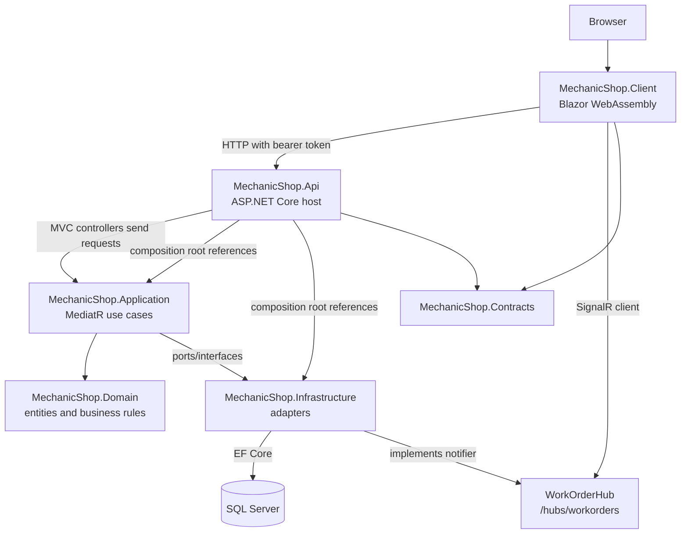
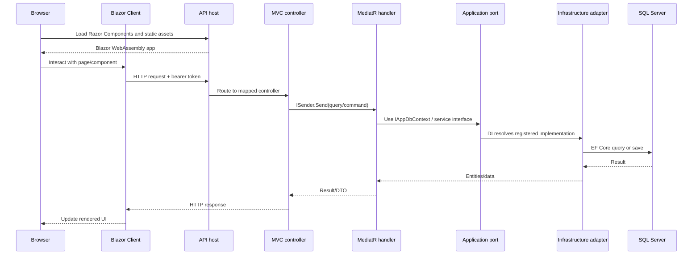

# Architecture overview

Scope: source tree on branch `main` of `fou1100ouacus/Mechanical-Shop`, inspected through the connected GitHub integration. This document describes observed project references and startup wiring; it does not claim runtime or test verification.

## Solution shape

`MechanicShop.slnx` contains six production projects under `src/` and five test/support projects under `tests/`. `Directory.Build.props` sets `net10.0`, nullable reference types, implicit usings, and latest language version. `Directory.Packages.props` centralizes package versions.

| Project | Responsibility and observed references |
|---|---|
| [`MechanicShop.Api`](../../src/MechanicShop.Api) | ASP.NET Core host and composition root; references Application, Infrastructure, Contracts, and Client. Hosts MVC controllers, the Blazor WebAssembly UI, static assets, and the SignalR hub. |
| [`MechanicShop.Application`](../../src/MechanicShop.Application) | Use cases organized by feature (commands, queries, handlers, validators, DTOs, mappers); references Domain. |
| [`MechanicShop.Domain`](../../src/MechanicShop.Domain) | Business entities, value/result/error types, rules, and domain events. It also references MediatR for event abstractions, so the domain is not package-free. |
| [`MechanicShop.Infrastructure`](../../src/MechanicShop.Infrastructure) | EF Core/SQL Server persistence, ASP.NET Identity/JWT, authorization policy implementation, cache, notifications, PDF generation, SignalR notifier, and hosted cleanup service; references Application to implement its ports. |
| [`MechanicShop.Contracts`](../../src/MechanicShop.Contracts) | Shared request contracts used by API and Client. |
| [`MechanicShop.Client`](../../src/MechanicShop.Client) | Blazor WebAssembly client; references Contracts and is hosted by Api. Contains pages/components, API client, auth state, bearer-token handler, and SignalR client. |
| [`MechanicShop.Api.IntegrationTests`](../../tests/MechanicShop.Api.IntegrationTests) | API integration tests. |
| [`MechanicShop.Application.SubcutaneousTests`](../../tests/MechanicShop.Application.SubcutaneousTests) | Application handler/validator tests using application test hosting. |
| [`MechanicShop.Application.UnitTests`](../../tests/MechanicShop.Application.UnitTests) | Application behaviors and mapper tests. |
| [`MechanicShop.Domain.UnitTests`](../../tests/MechanicShop.Domain.UnitTests) | Domain entity and rule tests. |
| [`MechanicShop.Tests.Common`](../../tests/MechanicShop.Tests.Common) | Shared test factories/builders and test user/time helpers. |

Other operational files include the GitHub Actions workflows under `.github/workflows`, API Dockerfile, root `docker-compose.yml`, Prometheus config, and Seq data/configuration under `containers/`. Compose defines API, SQL Server, Seq, Prometheus, and Grafana. These are deployment/observability concerns, not additional Clean Architecture layers.

## Layer and dependency diagram

### Diagram explanation

- Browser navigation loads the Blazor client through the API host. The host enables interactive WebAssembly rendering in `Program.cs`; `Components/App.razor` renders the client `Routes` component.
- Client calls use the named `MechanicShopClient` HttpClient with `BearerTokenHandler`. `ServiceApi` wraps the client-facing calls. The client also has a SignalR client for the work-order hub.
- The mapped MVC controllers construct Application queries/commands and send them through MediatR. Application handlers use `IAppDbContext` and other Application interfaces rather than directly constructing Infrastructure classes.
- Domain contains the business model. Application references Domain; Infrastructure references Application and Domain types through that dependency. Api references both Application and Infrastructure so it can register the graph at startup.
- Infrastructure’s `AppDbContext` implements `IAppDbContext`, uses SQL Server, and dispatches domain events during `SaveChangesAsync`. It also supplies the runtime implementations of the other registered Application ports.

## Runtime entry points

- Server entry point: [`src/MechanicShop.Api/Program.cs`](../../src/MechanicShop.Api/Program.cs). It registers presentation, application, and infrastructure services; configures Serilog; creates the app; configures environment-specific behavior; applies shared middleware; and maps controllers, UI, static assets, and SignalR.
- Client entry point: [`src/MechanicShop.Client/Program.cs`](../../src/MechanicShop.Client/Program.cs). It registers auth state, token handling, local storage, API services, timezone service, and SignalR client.
- MVC route definitions live in [`src/MechanicShop.Api/Controllers`](../../src/MechanicShop.Api/Controllers). `Program.cs` calls `MapControllers()`.
- There are also classes in [`src/MechanicShop.Api/Endpoints`](../../src/MechanicShop.Api/Endpoints) that define minimal API route groups. In the complete source tree inspected, no `MapWorkOrdersEndpoints` or equivalent `Map*Endpoints` call is wired from `Program.cs` or the registration extensions. Therefore these definitions are not evidenced as active routes; controllers are the route surface visibly mapped at startup.

## Main request path

### Diagram explanation

The first request is a host/UI request and does not necessarily enter a controller. For API calls, endpoint routing selects a controller, authorization metadata is enforced by the shared pipeline, and controller code translates HTTP inputs into Application requests. MediatR resolves the matching handler and registered pipeline behaviors. The handler accesses persistence or other capabilities through injected interfaces; DI binds those interfaces to Infrastructure implementations. The response returns through the handler and controller to the client, where Blazor updates the UI. SignalR work-order notifications are a separate real-time path through the mapped hub.

## Evidence boundaries

This map is based on the tracked remote source tree and selected project, DI, controller, startup, and infrastructure files. No source code was changed, and no build or tests were run. For exact registrations and middleware ordering, see [dependency-injection.md](dependency-injection.md), [middleware-pipeline.md](middleware-pipeline.md), and [Filter.md](Filter.md).