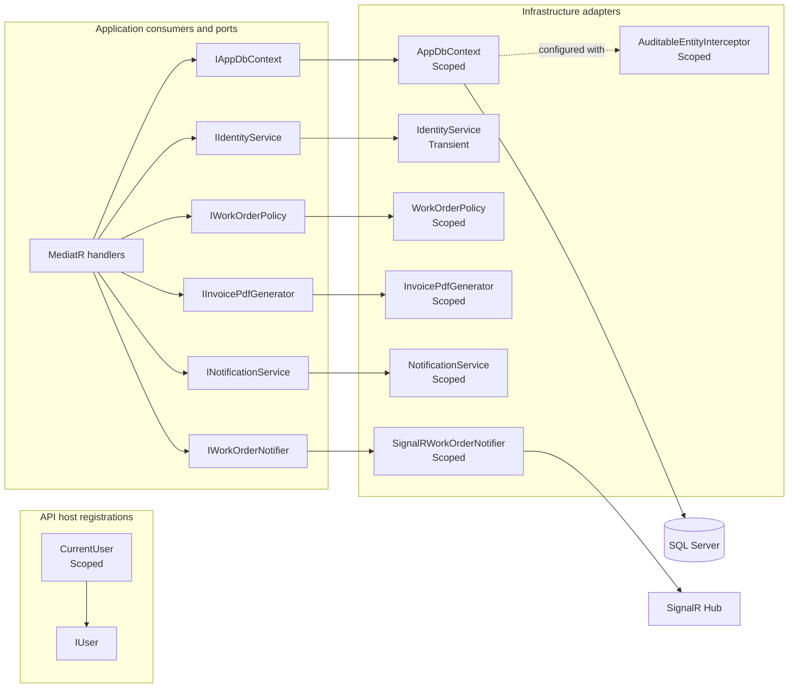
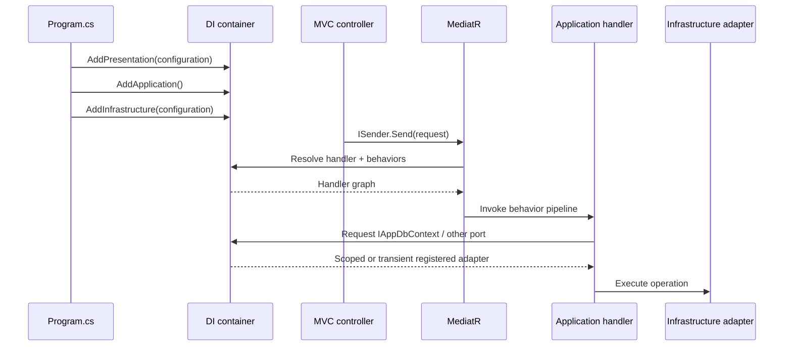

# Dependency injection map

Composition root: `src/MechanicShop.Api/Program.cs` calls `AddPresentation(configuration)`, `AddApplication()`, then `AddInfrastructure(configuration)`. The API project references both Application and Infrastructure; this is where inward-facing Application ports are bound to runtime adapters.

## Explicit application interface bindings

| Interface / service contract | Registered implementation | Lifetime | Registration | Observed role/dependency |
|---|---|---|---|---|
| `IUser` | `CurrentUser` (`MechanicShop.Api.Services`) | Scoped | `AddPresentation` → `AddIdentityInfrastructure` | Reads current request user; uses `IHttpContextAccessor`. |
| `IAppDbContext` | `AppDbContext` | Scoped | `AddInfrastructure` | Application handlers use the abstraction; the concrete context is also registered as EF Core `DbContext`. |
| `IIdentityService` | `IdentityService` | Transient | `AddInfrastructure` | Identity operations implemented using ASP.NET Identity services backed by `AppDbContext`. |
| `ITokenProvider` | `TokenProvider` | Scoped | `AddInfrastructure` | JWT/refresh-token support. |
| `IWorkOrderPolicy` | `WorkOrderPolicy` | Scoped | `AddInfrastructure` | Work-order policy used by work-order application handlers. |
| `IInvoicePdfGenerator` | `InvoicePdfGenerator` | Scoped | `AddInfrastructure` | Invoice PDF generation used by billing flow. |
| `INotificationService` | `NotificationService` | Scoped | `AddInfrastructure` | Notification capability used by application workflows. |
| `IWorkOrderNotifier` | `SignalRWorkOrderNotifier` | Scoped | `AddInfrastructure` | Publishes work-order notifications through SignalR. |
| `ISaveChangesInterceptor` | `AuditableEntityInterceptor` | Scoped | `AddInfrastructure` | Added to `AppDbContext` options and runs during EF Core save operations. |
| `IAuthorizationHandler` | `LaborAssignedHandler` | Scoped | `AddInfrastructure` | Evaluates the labor-assignment authorization requirement. |

`IAppDbContext` is a factory registration returning the already-registered scoped `AppDbContext`, so resolving both within one scope yields the same context instance. The context is configured with the scoped save interceptor and SQL Server provider. `AppDbContext.SaveChangesAsync` dispatches domain events through `IMediator` before saving.

## Other explicit application/client services

| Service | Lifetime | Registration and relationship |
|---|---|---|
| `TimeProvider.System` | Singleton | `AddInfrastructure`; shared system clock. |
| `ApplicationDbContextInitialiser` | Scoped | `AddInfrastructure`; called by the API only during Development startup. |
| `OverdueBookingCleanupService` | Hosted service (host-managed singleton) | `AddHostedService`; background cleanup service. |
| `AuthenticationStateProvider` → `CustomAuthenticationStateProvider` | Scoped | Client `Program.cs`; browser-side authentication state. |
| `IAccountManagement` → resolved `AuthenticationStateProvider` | Scoped factory | Client `Program.cs`; same scoped authentication-state object exposed through account-management interface. |
| `BearerTokenHandler` | Transient | Client `Program.cs`; attached to the named `MechanicShopClient` HttpClient pipeline. |
| `TimeZoneService` | Scoped | Client `Program.cs`. |
| `WorkOrderHubClient` | Scoped | Client `Program.cs`; SignalR client abstraction. |
| `ServiceApi` | Scoped | Client `Program.cs`; client API facade. |
| Named `MechanicShopClient` HttpClient | HttpClientFactory-managed | Client `Program.cs`; base address is the host address and the bearer handler is attached. |

## Assembly-scanned registrations and framework services

- `AddApplication()` scans the Application assembly for FluentValidation validators and MediatR handlers. It adds four MediatR open pipeline behaviors in this order: `ValidationBehavior`, `PerformanceBehaviour`, `UnhandledExceptionBehaviour`, `CachingBehavior`. The source does not specify lifetimes for these scanned registrations; MediatR and FluentValidation use their library defaults (MediatR handlers/behaviors are transient; FluentValidation validators are scoped by the registration extension default).
- `AddInfrastructure()` configures JWT bearer authentication, ASP.NET Core Identity (`AppUser`, roles, EF stores), authorization policies, HybridCache, and EF Core. These registrations are framework-managed; the source does not explicitly restate lifetimes for each internal framework service.
- `AddPresentation()` configures options for `AppSettings`, problem details, API versioning/OpenAPI, controllers, exception handling, CORS, rate limiting, output cache, OpenTelemetry, and SignalR. It also registers `IHttpContextAccessor` and the `IUser` adapter.
- `AddValidation()` currently returns `services` without adding a registration. Validation comes from Application assembly scanning and the MediatR validation behavior.

## Dependency diagram

### Diagram explanation

The API composition root supplies `IUser` because its implementation depends on the current HTTP request. Application handlers are discovered by MediatR scanning and depend on ports such as `IAppDbContext`, policies, and notification/PDF abstractions. Infrastructure supplies those port implementations; the arrows indicate only registrations and implementation relationships observed in the DI code. `AppDbContext` reaches SQL Server through EF Core configuration. The SignalR notifier publishes through the hub infrastructure. The diagram omits framework internals (Identity stores, JWT handler, cache internals) because they are registrations from framework extensions rather than hand-written adapter classes.

## Registration and resolution flow

### Diagram explanation

Registrations happen before `builder.Build()`. At request time, MVC controller activation and MediatR request dispatch resolve the handler graph from the container. The Application behaviors surround handler execution, while handler constructor dependencies are resolved using their declared DI lifetimes. A scoped service is shared for a request scope; the transient identity service is created per resolution; the system `TimeProvider` is shared. The client has a separate browser-side DI container configured in the WebAssembly entry point.

## Boundaries and unregistered contracts

`ICachedQuery` is a marker consumed by the caching behavior rather than a service adapter, so it has no direct DI implementation binding. `UtilityService` is a static helper class, not an injectable interface. The other Application service interfaces listed in `Common/Interfaces` are bound in the explicit table. Domain entities are created through their own factory methods; they are not registered as services. Static endpoint classes likewise are not DI service registrations.

Source references: [`Api/Program.cs`](../../src/MechanicShop.Api/Program.cs), [`Api/DependencyInjection.cs`](../../src/MechanicShop.Api/DependencyInjection.cs), [`Application/DependencyInjection.cs`](../../src/MechanicShop.Application/DependencyInjection.cs), [`Infrastructure/DependencyInjection.cs`](../../src/MechanicShop.Infrastructure/DependencyInjection.cs), [`Infrastructure/Data/AppDbContext.cs`](../../src/MechanicShop.Infrastructure/Data/AppDbContext.cs), and [`Client/Program.cs`](../../src/MechanicShop.Client/Program.cs).