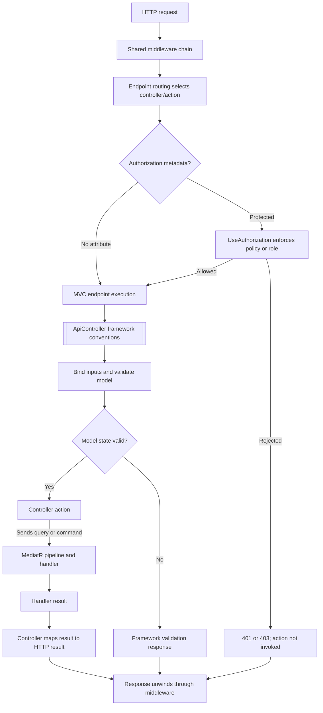

# MVC filters and endpoint attributes

Scope: source on `main`, inspected through the repository tree, API startup/registration, and controller files. This is a source-based inventory; no runtime trace or build was performed.

## Findings

The API registers controllers in [DependencyInjection.cs](../../src/MechanicShop.Api/DependencyInjection.cs) through `AddControllers().AddJsonOptions(...)`. The registration does not configure `MvcOptions.Filters` or add a global MVC filter. The inspected controller tree does not contain a custom `IActionFilter`, `IAsyncActionFilter`, `IResourceFilter`, `IExceptionFilter`, `IResultFilter`, or `IEndpointFilter` implementation.

All controllers inherit [ApiController](../../src/MechanicShop.Api/Controllers/ApiController.cs), marked `[ApiController]`. This enables framework-provided API controller conventions such as automatic invalid-model-state responses. The base class's `Problem(List<Error>)` method is an action-result helper, not a filter.

## What the project applies

| Source construct | Where observed | Runtime role |
|---|---|---|
| `[ApiController]` | `Controllers/ApiController.cs`, inherited by API controllers | ASP.NET Core API-controller conventions, including model-binding and validation behavior. Framework behavior; no project-authored filter class is shown. |
| `[Authorize]`, `[Authorize(Policy=...)]`, `[Authorize(Roles=...)]` | Customers, Dashboard, Invoices, Labors, RepairTasks, and WorkOrders controller/action metadata; Identity applies it to the current-user action | Endpoint authorization metadata consumed by `UseAuthorization()`; these attributes are not custom MVC filter implementations. Identity token actions and Settings have no class-level `[Authorize]` in the inspected source. |
| `[OutputCache(Duration = 60)]` | Customers list/by-id, Labors GET, RepairTasks list/by-id | Opts those actions into output caching configured by `AddOutputCache` and `UseOutputCache()`. It is not an MVC action filter. |
| `[Route]`, `[HttpGet/Post/Put/Delete]`, API version and binding attributes | Controller/action declarations | Routing, version, and model-binding metadata; not filters. |
| `[ProducesResponseType]`, `[EndpointSummary]`, `[EndpointDescription]`, `[EndpointName]` | Controller actions | API/OpenAPI metadata; not execution filters. |

The visible framework convention attribute is `[ApiController]`. The project also uses authorization and output-cache attributes, whose behavior is carried out by the corresponding middleware. Swagger UI's `.EnableFilter()` in [Program.cs](../../src/MechanicShop.Api/Program.cs) enables filtering/search in the Swagger UI document list; it does not register an MVC filter.

## Request path through MVC and the application



### Diagram explanation

The host's shared middleware chain runs before the selected endpoint. Endpoint routing supplies controller/action metadata. For protected routes, `UseAuthorization()` evaluates `[Authorize]` metadata and can end the request before MVC invokes the action. The request then enters MVC, where inherited `[ApiController]` conventions participate in binding and validation. Invalid model state can produce a framework response without entering the action. Valid requests enter the controller, which sends application commands or queries through MediatR; controller result helpers then create the HTTP response.

The diagram does not insert a custom MVC filter stage because no custom filter implementation or global MVC filter registration was found in the inspected API source. Standard ASP.NET Core MVC framework execution still applies.

## Output caching relationship

```mermaid
flowchart LR
  Registration[AddOutputCache<br/>base expiry 60 seconds] --> Middleware[UseOutputCache]
  Middleware --> Endpoint[Mapped MVC endpoint]
  Attribute[[Selected action has OutputCache(Duration = 60)]] -. endpoint metadata .-> Middleware
  Middleware --> Response[Serve cached response or run endpoint and cache eligible response]
```

### Diagram explanation

`AddOutputCache` configures output caching and a 60-second base policy; `UseOutputCache` places the middleware in the shared pipeline after authorization. Five actions have explicit `[OutputCache(Duration = 60)]` metadata: Customers list and by-id, Labors GET, and RepairTasks list and by-id. This inventory reports source attributes and registration. It does not assert that every response is cacheable or that a cache hit occurs.

## Validation outside MVC filters

`AddValidation()` in API presentation registration is empty. Application validation is instead wired through the Application project's MediatR pipeline behavior and validators (see [dependency-injection.md](dependency-injection.md)). That behavior runs when controllers send MediatR requests; it is not an ASP.NET Core MVC filter.

## Source references

- [API startup and endpoint mapping](../../src/MechanicShop.Api/Program.cs)
- [Presentation registration and middleware order](../../src/MechanicShop.Api/DependencyInjection.cs)
- [API controller base and Problem result helper](../../src/MechanicShop.Api/Controllers/ApiController.cs)
- Controller files: [Customers](../../src/MechanicShop.Api/Controllers/CustomersController.cs), [Dashboard](../../src/MechanicShop.Api/Controllers/DashboardController.cs), [Identity](../../src/MechanicShop.Api/Controllers/IdentityController.cs), [Invoices](../../src/MechanicShop.Api/Controllers/InvoicesController.cs), [Labors](../../src/MechanicShop.Api/Controllers/LaborsController.cs), [RepairTasks](../../src/MechanicShop.Api/Controllers/RepairTasksController.cs), [Settings](../../src/MechanicShop.Api/Controllers/SettingsController.cs), [WorkOrders](../../src/MechanicShop.Api/Controllers/WorkOrdersController.cs)
- [Global exception handler](../../src/MechanicShop.Api/Infrastructure/GlobalExceptionHandler.cs)

Framework references: [ASP.NET Core MVC filters](https://learn.microsoft.com/en-us/aspnet/core/mvc/controllers/filters?view=aspnetcore-10.0) and [ASP.NET Core output caching](https://learn.microsoft.com/en-us/aspnet/core/performance/caching/output?view=aspnetcore-10.0).
