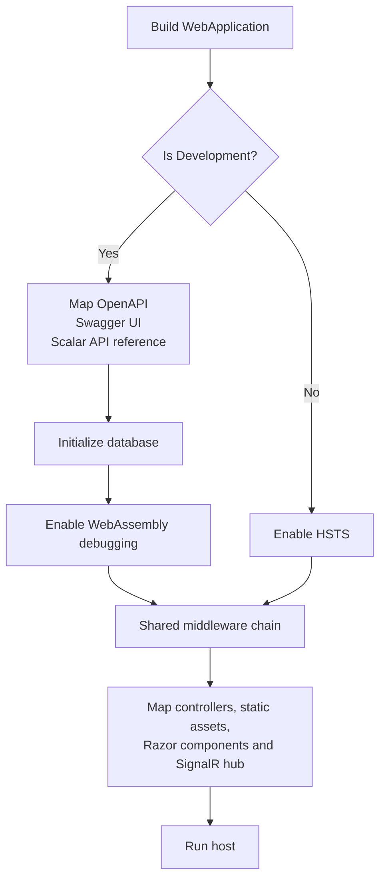
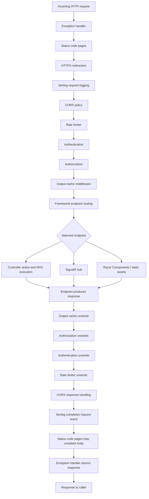

# Middleware and request pipeline

Primary source: [API startup](../../src/MechanicShop.Api/Program.cs) and [presentation registration](../../src/MechanicShop.Api/DependencyInjection.cs). This describes the pipeline as wired in source; no runtime trace was collected.

## Environment branching at startup

### Diagram explanation

The environment branch is evaluated once while the host is built, not independently for each request. Development maps API documentation, initializes the database via `InitialiseDatabaseAsync()`, and enables WebAssembly debugging. The `else` branch applies HSTS. Both branches then enter the same `UseCoreMiddlewares` chain and map application endpoints. The source does not show database initialization in non-Development startup.

## Explicit middleware order

`Program.cs` calls `UseCoreMiddlewares` before mapping endpoints. The extension in `DependencyInjection.cs` adds these middleware in this order:

1. `UseExceptionHandler()` — the registered `GlobalExceptionHandler` formats unhandled downstream exceptions.
2. `UseStatusCodePages()` — supplies a body for otherwise empty error status responses.
3. `UseHttpsRedirection()` — may redirect HTTP requests to HTTPS.
4. `UseSerilogRequestLogging()` — logs requests that reach it.
5. `UseCors(configuredPolicy)` — applies the policy named by `AppSettings:CorsPolicyName`.
6. `UseRateLimiter()` — activates rate-limiting middleware. Registration defines a named sliding-window limiter with 100 permits/minute, six segments, and queue limit 10.
7. `UseAuthentication()` — establishes the request principal using the configured authentication scheme.
8. `UseAuthorization()` — enforces endpoint authorization metadata and policies.
9. `UseOutputCache()` — enables output caching for participating endpoints.

After the shared chain, `Program.cs` maps controllers, applies antiforgery middleware, maps static assets, maps Razor Components with Interactive WebAssembly rendering, and maps the SignalR hub at `/hubs/workorders`.

There is no explicit `UseRouting()` call. `WebApplication` supplies endpoint routing for mapped endpoints. The `Map...` calls register endpoints; their textual order is not a linear series of endpoint executions.

## Request and response flow

### Diagram explanation

On the inbound path, requests pass through the explicitly registered middleware order. Endpoint routing selects a candidate endpoint and makes its metadata available to authorization and other endpoint-aware middleware. A middleware can short-circuit: HTTPS redirection may return a redirect; CORS preflight can complete before endpoint execution; rate limiting may reject; authorization may return a challenge or forbid response. If an endpoint runs, it creates the response. The response then unwinds through middleware that entered for the request. The exception handler can translate unhandled downstream exceptions, and status-code pages can add a body to otherwise empty error responses.

The framework adds endpoint routing for this `WebApplication`; the diagram distinguishes route selection from the explicit middleware calls. MVC action execution and MVC conventions are detailed in [Filter.md](Filter.md).

## Middleware branches and endpoint-specific behavior

- **Environment:** Development maps OpenAPI/Swagger/Scalar, initializes the database, and enables WebAssembly debugging. Non-Development applies HSTS. Both use the shared middleware chain.
- **HTTPS:** `UseHttpsRedirection` can return a redirect before endpoint execution.
- **CORS:** the configured policy allows configured origins, any headers and methods, and credentials. Preflight handling may complete a request early.
- **Rate limiting:** `AddAppRateLimiting` defines named policy `SlidingWindow`; `UseRateLimiter` is in the shared chain. The named policy definition alone does not establish that every route selects it.
- **Authorization:** controller attributes provide policy/role metadata consumed by `UseAuthorization()`. `MapRazorComponents<App>().AllowAnonymous()` explicitly marks the Razor endpoint anonymous.
- **Output cache:** explicitly attributed actions are listed with their MVC behavior in [Filter.md](Filter.md).
- **Error handling:** action helpers may return Problem Details without throwing; unhandled exceptions go to `GlobalExceptionHandler`.
- **Endpoint mapping:** `Program.cs` maps MVC controllers, Razor Components, static assets, and SignalR. The source tree also contains minimal API endpoint mapping classes, but startup does not call their mapping extensions; they are not included as active mapped routes here.

## Classes present but not wired into the observed chain

`RequestLogContextMiddleware` exists under `Api/Infrastructure`, but no `UseMiddleware<RequestLogContextMiddleware>()` call appears in the inspected startup/registration. It is therefore not part of the observed chain.

See [Filter.md](Filter.md) for the MVC conventions, authorization metadata, output-cache attributes, and filter inventory.
