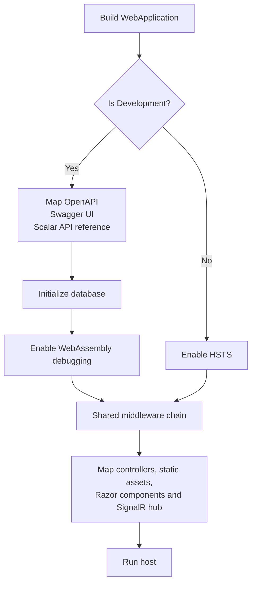
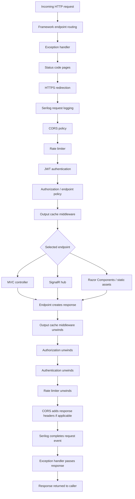

# Middleware and request pipeline

Primary source: [`src/MechanicShop.Api/Program.cs`](../../src/MechanicShop.Api/Program.cs) and [`src/MechanicShop.Api/DependencyInjection.cs`](../../src/MechanicShop.Api/DependencyInjection.cs). This describes the pipeline as wired in source; no runtime trace was collected.

## Environment branching at startup

### Diagram explanation

The branch is evaluated once while the host is built, not independently for each request. Development maps API documentation, initializes the database via `InitialiseDatabaseAsync()`, and enables WebAssembly debugging. The `else` branch applies HSTS. Both branches then enter the same `UseCoreMiddlewares` chain and map the application endpoints. Therefore the source does not show database initialization occurring in Production startup. OpenAPI/Swagger/Scalar setup and WebAssembly debugging are Development-only; HSTS is Production-only in this branch.

## Explicit middleware order

`Program.cs` calls `UseCoreMiddlewares` before mapping endpoints. Within that extension, the order is:

1. `UseExceptionHandler()` — uses the registered `GlobalExceptionHandler` to turn unhandled downstream exceptions into the configured error response.
2. `UseStatusCodePages()` — supplies a body for otherwise empty error status responses.
3. `UseHttpsRedirection()` — redirects HTTP requests to HTTPS where configured.
4. `UseSerilogRequestLogging()` — records request/response information for requests that reach it.
5. `UseCors(configuredPolicy)` — applies the named policy from `AppSettings:CorsPolicyName`.
6. `UseRateLimiter()` — activates the configured rate-limiting middleware; the registration defines a named sliding-window limiter with 100 permits/minute, six segments, and queue limit 10.
7. `UseAuthentication()` — establishes the principal using the configured JWT bearer scheme.
8. `UseAuthorization()` — enforces endpoint authorization metadata and policies.
9. `UseOutputCache()` — enables ASP.NET Core output-cache processing for endpoints that participate in it.

After the shared chain, `Program.cs` calls/declares `MapControllers()`, `UseAntiforgery()`, `MapStaticAssets()`, `MapRazorComponents<App>()` with Interactive WebAssembly rendering and the Client assembly, and `MapHub<WorkOrderHub>("/hubs/workorders")`, then `Run()`.

ASP.NET Core `WebApplication` supplies endpoint routing for the mapped endpoints; there is no explicit `UseRouting()` call in the source. The `Map...` calls register endpoints and are not ordinary middleware that execute in the textual order as a linear chain. The effective endpoint is selected by routing and then its endpoint metadata is available to authorization and other endpoint-aware middleware.

## Request and response flow

### Diagram explanation

On the inbound path, routing identifies a candidate endpoint. The exception handler surrounds the downstream chain so it can handle exceptions from later middleware or endpoint execution. Status-code pages can add a response body when later work returns an otherwise empty error status. HTTPS redirection may short-circuit an HTTP request with a redirect. Requests that continue pass through logging, CORS, rate limiting, authentication, authorization, and output caching before endpoint execution.

On the outbound path, the selected endpoint first creates the response. The response then unwinds through the middleware that ran for that request. CORS can add its response headers, Serilog finishes its request event, and the exception handler returns normally unless it handled an exception. If a middleware short-circuits the request, later middleware and the endpoint do not run; the response unwinds only through middleware that already entered.

The routing box is shown first because endpoint-aware middleware needs route metadata. `WebApplication` adds routing around the configured pipeline when endpoints are mapped; it is implicit rather than an explicit `UseRouting()` statement in `Program.cs`.

## Request branches and endpoint-specific behavior

- **Environment branch:** Development and non-Development host setup differ as shown above. The shared chain is used in both branches.
- **HTTPS redirect:** `UseHttpsRedirection` can end an insecure request with a redirect before controller execution.
- **CORS:** the named policy permits configured origins, any headers/methods, and credentials. CORS preflight handling can complete a request before endpoint execution.
- **Rate limiting:** `AddAppRateLimiting` defines a named policy `SlidingWindow` and `UseRateLimiter` is in the shared chain. A named policy’s existence alone does not prove that every route selects it; route-specific application is governed by endpoint metadata, so the documentation does not claim universal enforcement.
- **Authentication and authorization:** controllers can carry `[Authorize]` and role/policy metadata; the controller set includes protected work-order routes. The static endpoint definitions also declare `.RequireAuthorization()`, but the startup path does not call their mapping extensions. `MapRazorComponents<App>().AllowAnonymous()` explicitly allows the UI endpoint.
- **Error handling:** errors mapped by application result helpers can return Problem Details without throwing; unhandled exceptions flow to `GlobalExceptionHandler`. `UseStatusCodePages` concerns error responses whose body is otherwise absent.
- **Static assets, Razor UI, MVC, and SignalR:** requests are dispatched to their respective endpoint types after the shared pipeline. The hub route is `/hubs/workorders`.

## Source items present but not wired into this chain

`RequestLogContextMiddleware` exists under `Api/Infrastructure`, but there is no `UseMiddleware<RequestLogContextMiddleware>()` call in `Program.cs` or `UseCoreMiddlewares`. It is therefore not part of the observed middleware pipeline. Likewise, `Api/Endpoints/*.cs` defines minimal API mapping extension methods, but a repository-wide source inspection found no call to those mapping methods from startup. The active route mapping visibly uses `MapControllers()`.

Source references: [`Api/Program.cs`](../../src/MechanicShop.Api/Program.cs), [`Api/DependencyInjection.cs`](../../src/MechanicShop.Api/DependencyInjection.cs), [`Api/Infrastructure/GlobalExceptionHandler.cs`](../../src/MechanicShop.Api/Infrastructure/GlobalExceptionHandler.cs), [`Api/Infrastructure/RequestLogContextMiddleware.cs`](../../src/MechanicShop.Api/Infrastructure/RequestLogContextMiddleware.cs), and [`Api/Controllers`](../../src/MechanicShop.Api/Controllers).